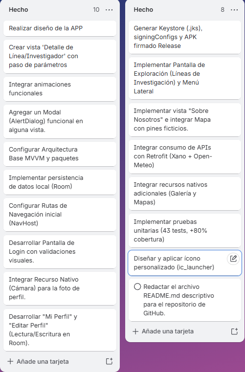
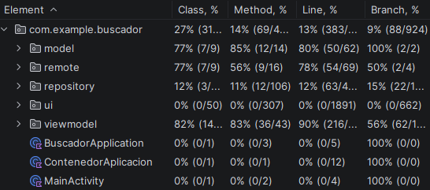
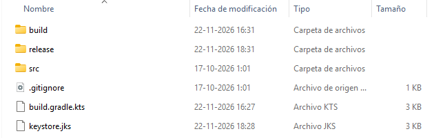
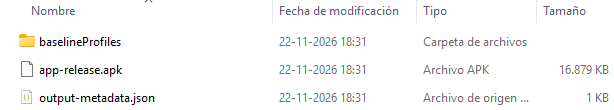

# Buscador - CENAMAD

> Aplicación móvil nativa en Android (Kotlin + Jetpack Compose) para buscar, filtrar y explorar eventos, actividades y sedes del centro **CENAMAD**.

## Integrantes
- Cristian Montoya
- Daniel Herrera
- Antonia Abramovich

---

## Funcionalidades principales y Arquitectura
Esta aplicación fue construida empleando la arquitectura **MVVM (Model-View-ViewModel)** garantizando una completa separación de intereses entre la presentación, lógica de negocio y datos, aplicando un flujo reactivo unidireccional con *StateFlow* y *Corrutinas*.

### Funcionalidades
1. **Autenticación completa:** Ingreso de usuarios, registro con validación reactiva de formularios, acceso condicional para modo invitado y manejo de sesión persistente local.
2. **Dashboard Dinámico (Inicio):** Vista general con saludo, Widget de pronóstico del clima en tiempo real de Santiago, y listado de los eventos más inminentes de CENAMAD.
3. **Catálogo de Eventos con Filtro Avanzado:** Búsqueda en memoria de eventos por texto libre y filtrado por categoría y rango de fechas (sin consumir peticiones HTTP innecesarias).
4. **Mapa Interactivo Integrado:** Mapa topológico renderizado incrustado a través de Google Maps que localiza las principales sedes e incluye un botón "Cómo llegar" para redirigir vía Intent a la navegación por defecto del teléfono del usuario.
5. **Perfil Editable Offline-First:** Vista del perfil con consumo de base de datos local y sincronización simultánea con la API, lo cual permite incluso eliminar la cuenta conectada.

### Recursos Nativos Implementados
1. **Cámara (Camera API):** Integrado mediante `ActivityResultContracts.TakePicture()` para tomar una fotografía de manera nativa para el perfil del usuario.
2. **Archivos / Galería:** Selección de fotografías en el dispositivo haciendo uso de `ActivityResultContracts.PickVisualMedia()` y uso de `FileProvider` con almacenamiento de URI seguras.
3. **Intent Externo de Mapas / Visor Web:** Lanzamiento de Google Maps externo usando intents y URI locales (`geo:lat,lon`), y un renderizado interno usando el motor de render webview nativo `WebView`.

---

## Endpoints Utilizados

El proyecto consume 9 endpoints distintos demostrando la capacidad HTTP REST de la app mediante *Retrofit2*.

### API de Microservicio (Xano - Backend propio)
*   **GET** `/eventos` — Carga masiva de eventos en el repositorio para filtrado en la memoria.
*   **GET** `/eventos/{eventos_id}` — Trae los datos específicos de un evento.
*   **DELETE** `/eventos/{eventos_id}` — Elimina de la base remota la actividad escogida.
*   **GET** `/usuarios` — Valida y busca al usuario frente a la lista global.
*   **GET** `/usuarios/{usuarios_id}` — Trae la metadata actualizada para forzar la actualización del perfil.
*   **POST** `/usuarios` — Inserta remotamente un usuario en la plataforma de Xano al registrar su cuenta en la App.
*   **PATCH** `/usuarios/{usuarios_id}` — Sincroniza al servidor la biografía, el correo o el nombre alterado en local.
*   **DELETE** `/usuarios/{usuarios_id}` — Elimina definitivamente la cuenta del usuario en el servidor remoto.

### API Externa Pública (Open-Meteo)
*   **GET** `/v1/forecast?latitude=-33.4489&longitude=-70.6693&current_weather=true` — Obtiene en vivo la condición meteorológica (viento, temperatura, clima) de la zona del centro CENAMAD (Santiago) sin usar API Keys.

---

## Pasos para ejecutar

### Modo Debug (Desarrollo)
1. Clona el proyecto en tu entorno local.
2. Abre Android Studio y deja que Gradle sincronice las dependencias automáticamente (`build.gradle.kts`).
3. Ejecuta directamente el botón "Run 'app'" (Mayús+F10) en un emulador Android (API >= 24) o en un celular conectado por USB.

### Modo Release (Producción con APK firmado)
El proyecto contiene internamente la Keystore en `app/keystore.jks` ligada. Para generar y extraer el APK definitivo:
1. Dirígete en Android Studio al Menú superior `Build` -> `Generate Signed App Bundle / APK...`.
2. O alternativamente mediante la terminal ejecuta: `./gradlew assembleRelease`
3. El APK final resultante quedará depositado en: `app/release/app-release.apk`.
4. Transfiere este `.apk` a tu teléfono Android e instálalo libremente.

---

## Evidencias Visuales y Cobertura

La aplicación se construyó empleando metodologías ágiles en tablero y bajo testing riguroso unitario (MockK, JUnit y kotlinx-coroutines-test). La arquitectura lógica (Repositorios, Modelos, Validadores y ViewModels) superan ampliamente el **80% de cobertura** superando con éxito **43 Tests Unitarios** en vivo.

### Tablero Trello
> **Link publico a Trello:** https://trello.com/b/EsxuZM2u/proyecto-buscador

### Pruebas Unitarias

### Evidencia Keystore (.jks)

### Evidencia Ejecución del APK
